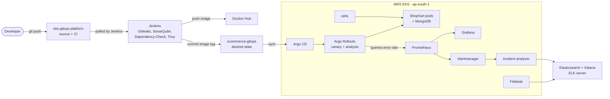

<div align="center">

# GitOps Kubernetes Platform on AWS EKS

**DevSecOps · GitOps · Progressive Delivery · Observability · Automated Incident Reports · Cost Alerts**

A production-style cloud engineering lab that takes a Node.js ecommerce app from `git push` to a canary release on Amazon EKS, with security scanning, monitoring, centralized logging and cost controls.


[Overview](#overview) · [Architecture](#architecture) · [CI/CD](#cicd-pipeline) · [Results](#results) · [Getting started](#getting-started) · [Demos](#demos) · [Security](#security) · [Cost and cleanup](#cost-and-cleanup)

</div>

---

## Overview

ShopKart is a sample Node.js/Express storefront backed by MongoDB. Around it, this project builds the delivery platform a real team would run:

- **Infrastructure as code:** VPC, EKS cluster, node group and ELK server provisioned with Terraform and S3 remote state.
- **Secure CI:** every build runs secret scanning, code quality, dependency and container scans before an image is published.
- **GitOps deployment:** Jenkins only builds and updates a Git repo. Argo CD deploys from it, so Jenkins never touches the cluster.
- **Progressive delivery:** Argo Rollouts shifts a new version in steps and checks the error rate in Prometheus.
- **Observability and response:** Prometheus, Grafana, Filebeat/Elasticsearch/Kibana and a rule-based incident analyzer.
- **Autoscaling and FinOps:** HPA on CPU, plus AWS Budgets and Cost Anomaly Detection.

### Two repositories

| Repository | Responsibility |
| --- | --- |
| [`eks-gitops-platform`](https://github.com/Mahendra0456/eks-gitops-platform) | Application source, Dockerfile, Jenkins pipeline, Terraform, monitoring and logging config, scripts, docs |
| [`ecommerce-gitops`](https://github.com/Mahendra0456/ecommerce-gitops) | Desired Kubernetes state: Helm chart, image tag, replicas, HPA, rollout strategy and the Argo CD application |

> **Design principle:** Jenkins builds, scans, publishes and commits the new image tag. Argo CD reconciles the cluster to match Git.

---

## Technology stack

| Area | Tools |
| --- | --- |
| Cloud | AWS (VPC, EKS, EC2, NAT Gateway, EBS, S3), region `ap-south-1` |
| Infrastructure as code | Terraform, S3 remote state with versioning |
| CI/CD | Jenkins, GitHub, Docker, Docker Hub |
| DevSecOps | Gitleaks, SonarQube (custom Quality Gate), OWASP Dependency-Check, Trivy |
| GitOps and delivery | Argo CD, Helm, Argo Rollouts (canary with Prometheus analysis) |
| Monitoring and alerting | Prometheus, Grafana, Alertmanager, Metrics Server |
| Logging | Filebeat, Elasticsearch, Kibana |
| Application | Node.js, Express, MongoDB |
| Incident response | Rule-based incident analyzer (writes reports to Elasticsearch) |
| Cost visibility | AWS Budgets, AWS Cost Anomaly Detection |

---

## Architecture

<p align="center">
  
</p>

### Simplified flow



**Flow in words**

1. A push to `eks-gitops-platform` is picked up by Jenkins through SCM polling.
2. The pipeline scans, tests and builds the image, then pushes `ecommerce:<build-number>` to Docker Hub.
3. Jenkins commits the new tag to `ecommerce-gitops`.
4. Argo CD syncs the change; Argo Rollouts releases it in steps (25%, 50%, 100%) and runs an `error-rate` analysis against Prometheus.
5. Prometheus feeds Grafana and Alertmanager. Alerts reach the incident analyzer, which stores a classified report in Elasticsearch.
6. Filebeat ships container logs to Elasticsearch for search in Kibana.
7. The HPA keeps between 4 and 6 replicas at a 50% CPU target.

**Notes**

- Infrastructure and cost controls are separate Terraform stacks, so the cost alerts survive an EKS teardown.
- Canary steps are pod-count based, not service-mesh traffic splitting.
- The incident analyzer is rule-based. It is not an LLM.
- Budget and anomaly notifications are alerts, not spending limits.

---

## CI/CD pipeline

Defined in `jenkins/Jenkinsfile`.

| # | Stage | Purpose |
| --- | --- | --- |
| 1 | Checkout | Fetch application source |
| 2 | Secret Scan (Gitleaks) | Detect committed secrets |
| 3 | Code Quality (SonarQube) | Static analysis and Quality Gate |
| 4 | Dependency Scan (OWASP Dependency-Check) | Known-vulnerable dependencies |
| 5 | Filesystem Scan (Trivy) | Scan files and dependencies |
| 6 | Install and Test | Install packages and run tests |
| 7 | Docker Build | Build the image |
| 8 | Image Scan (Trivy) | Scan the built image |
| 9 | Push Image | Publish to Docker Hub |
| 10 | Update GitOps Repo | Commit the new image tag to `ecommerce-gitops` |

If a security gate fails, the build stops before the image is published.

---

## Results

Captured from a real deployment on EKS in `ap-south-1`. The infrastructure was destroyed after testing to avoid cost, so there is no live URL; the screenshots are the evidence.

### Pipeline and registry

<table>
<tr>
<td width="50%"><b>Jenkins stage view</b><br/>Ten stages; builds #3 to #5 pass. Build #2 failed earlier and was fixed.<br/><br/></td>
<td width="50%"><b>Image published to Docker Hub</b><br/>The pipeline pushes <code>mahendra46/ecommerce</code> with the build number as the tag.<br/><br/></td>
</tr>
<tr>
<td colspan="2"><b>SonarQube custom Quality Gate (<code>ecom-gate</code>)</b><br/><br/></td>
</tr>
</table>

### GitOps delivery and canary rollout

<table>
<tr>
<td width="50%"><b>Argo CD application</b><br/><code>ecommerce</code> is Synced and Healthy.<br/><br/></td>
<td width="50%"><b>Argo Rollouts</b><br/>Canary completed at step 6 of 6 (100%), image <code>ecommerce:5</code> stable, successful analysis runs for each revision.<br/><br/></td>
</tr>
</table>

### The running application

<table>
<tr>
<td width="50%"><b>ShopKart v1</b><br/><br/></td>
<td width="50%"><b>ShopKart v2</b> after a Git push went through Jenkins, Argo CD and the canary<br/><br/></td>
</tr>
</table>

### Autoscaling, metrics and logs

<table>
<tr>
<td width="50%"><b>HPA under load</b><br/>CPU rose above the 50% target and replicas scaled from 4 to 5 (limits 4 to 6).<br/><br/></td>
<td width="50%"><b>Grafana</b><br/>Kubernetes compute resources by namespace.<br/><br/></td>
</tr>
<tr>
<td colspan="2"><b>Kibana</b><br/>Filebeat container logs, filtered to the <code>argocd</code> namespace.<br/><br/></td>
</tr>
</table>

---

## Getting started

The full step-by-step runbook, including checks after every phase and fixes for common errors, is in [`docs/BUILD_GUIDE.md`](docs/BUILD_GUIDE.md).

### Prerequisites

- AWS account with permissions for EKS, EC2, VPC, IAM, S3 and Budgets (region `ap-south-1`)
- GitHub access to both repositories
- Docker Hub account and access token with push rights
- NVD API key (for Dependency-Check)
- Your laptop's public IP and an EC2 key pair

### Phases

1. **Prepare accounts and credentials.** Confirm AWS is clean of leftovers from earlier runs.
2. **Launch the DevOps server** (Jenkins, SonarQube, Terraform, kubectl) and open its UIs through an SSH tunnel.
3. **Clone the two repos** and install the tools with `scripts/install-tools.sh`.
4. **Configure and create the Terraform state bucket** with `configure.sh`.
5. **Provision EKS** with `terraform init`, `plan`, `apply` in `terraform-eks/`.
6. **Bootstrap the cluster** with `scripts/cluster-bootstrap.sh` (Argo CD, Rollouts, Prometheus stack, Filebeat, analyzer).
7. **Configure Jenkins** credentials and the `ecommerce-pipeline` job.
8. **Run the first build**, then create the Argo CD application. The GitOps repo starts with a placeholder image tag, so the first build must come first.
9. **Run the demos,** configure the cost stack, capture evidence.
10. **Tear down** the same day.

### Handy checks

```bash
aws sts get-caller-identity
kubectl get nodes
kubectl get applications -n argocd
kubectl argo rollouts get rollout ecommerce -n ecommerce
kubectl get hpa -n ecommerce
kubectl logs deploy/incident-analyzer -n monitoring --tail=50
```

---

## Demos

Run these only when the app is healthy, and restore the intended GitOps state after each failure demo.

| Demo | What you do | What to expect |
| --- | --- | --- |
| **1. Good release** | Change the page heading, push to `eks-gitops-platform` | Jenkins builds, pushes a new tag, Argo CD syncs, canary moves 25%, 50%, 100% |
| **2. Bad release** | Set `failRate: "0.5"` in the GitOps values and send traffic | Canary fails the `error-rate` analysis and the rollout aborts or degrades while stable pods keep serving. Revert the commit afterward |
| **3. Database outage** | Set the MongoDB replicas to `0` through Git and send traffic | App returns 5xx, `HighErrorRate` fires, the analyzer writes a report to the `incident-reports` index. Revert afterward |
| **4. Autoscaling** | Generate heavy traffic with `scripts/traffic.sh` | HPA raises replicas between 4 and 6 when CPU passes 50% |

Outcomes depend on traffic, metrics and timing. Always check the real rollout status.

---

## Security

- Credentials live in Jenkins Credentials, never in source files.
- Terraform state, `.tfvars` files, kubeconfigs and private keys are not committed.
- SonarQube, Grafana and Argo CD are reached only through SSH tunnels. Jenkins (8080), Kibana (5601) and SSH (22) accept traffic only from the owner's IP.
- Elasticsearch (9200) is reachable only from inside the VPC.
- Jenkins uses a dedicated, write-enabled deploy key for the GitOps repo only.
- Scanner findings are reviewed, not ignored.
- Elasticsearch and Kibana run with security disabled (lab setting).
- This is a learning lab. TLS, hardened IAM, backups and network policies would be needed before any production use.

---

## Cost and cleanup

EKS, worker nodes, the NAT gateway, load balancers, EBS volumes and the ELK server all bill by the hour. Plan to tear down the same day.

- **Do not delete the Terraform state bucket before `terraform destroy` finishes.** A missing state makes cleanup manual.
- Run `scripts/teardown.sh`, make sure both leftover lists are empty, then confirm `Destroy complete!`.
- Afterward check the console for EKS clusters, NAT gateways, Elastic IPs, load balancers, volumes and the leftover VPC.
- Budgets and anomaly alerts notify you but do not stop spending.

---

## Repository structure

```text
eks-gitops-platform/
├── ai/incident-analysis/     # Rule-based incident analyzer
├── application/              # ShopKart Node.js application
├── cluster/                  # Kubernetes storage configuration
├── docker/                   # Dockerfile, Compose, Nginx configuration
├── loadtest/                 # k6 load test
├── configure.sh              # Fills placeholders, creates the state bucket
├── .gitleaks.toml            # Secret-scan rules
├── jenkins/Jenkinsfile       # CI pipeline
├── logging/                  # Filebeat configuration
├── monitoring/               # Prometheus, Alertmanager, analyzer configuration
├── scripts/                  # Install, bootstrap, traffic and teardown scripts
├── terraform-eks/            # VPC, EKS and ELK infrastructure
├── terraform-cost/           # AWS Budgets and anomaly detection
└── docs/
    ├── BUILD_GUIDE.md
    ├── architecture-diagram.png
    └── screenshots/

ecommerce-gitops/
├── argocd/application.yaml
└── apps/ecommerce/
    ├── Chart.yaml
    ├── values.yaml
    └── templates/            # Rollout, HPA, service, MongoDB, monitoring
```

---

## Scope and limitations

- Results depend on AWS permissions, quotas and region support.
- The incident analyzer is rule-based, and its output is not a guaranteed diagnosis.
- Canary progression uses pod counts, not a service mesh.
- Elasticsearch has no authentication or TLS in this lab, and the ELK server is a single node with no backups.
- A green CI build alone does not prove a healthy deployment; check Argo CD, the rollout and observability too.

---

## Author

**Mahendra Swain**, DevOps / Cloud Engineer

[GitHub: @Mahendra0456](https://github.com/Mahendra0456) · [eks-gitops-platform](https://github.com/Mahendra0456/eks-gitops-platform) · [ecommerce-gitops](https://github.com/Mahendra0456/ecommerce-gitops)

<div align="center">

*Built to demonstrate secure delivery, declarative operations, progressive releases, observable systems and cost-aware cloud engineering.*

</div>
