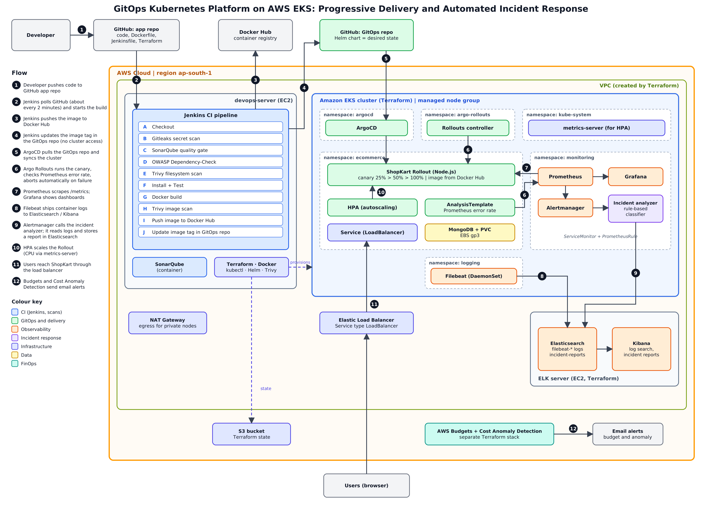

# GitOps Kubernetes Platform on AWS EKS

**Progressive delivery, DevSecOps scanning, observability and automated incident analysis, built end to end on AWS.**

A small Node.js + MongoDB shop (ShopKart) is the workload. The project is the platform around it: infrastructure as code, a secured CI pipeline, GitOps deployment, canary releases that abort themselves, monitoring, central logging, and an incident analyzer that turns alerts into classified reports.



## How a change reaches production

1. A push to this repo is picked up by **Jenkins** (SCM polling, about every 2 minutes).
2. Jenkins runs **Gitleaks**, **SonarQube** (quality gate), **OWASP Dependency-Check** and **Trivy** (filesystem and image). A failing gate stops the pipeline.
3. Jenkins builds the image, pushes it to Docker Hub, and writes the new tag into the **GitOps repo**. It never touches the cluster.
4. **ArgoCD** sees the commit and syncs the cluster.
5. **Argo Rollouts** shifts traffic in canary steps (25%, 50%, 100%) and checks the Prometheus error rate. A bad release is aborted automatically and the stable version keeps serving.
6. **Prometheus + Grafana** show metrics, **Filebeat + Elasticsearch + Kibana** collect logs, and **Alertmanager** calls the **incident analyzer**, which classifies the errors (type, severity, probable cause, next steps) and stores a report in Elasticsearch.

## What is in this repository

| Path | Purpose |
|---|---|
| `application/` | ShopKart (Express + MongoDB), `/health`, Prometheus `/metrics`, failure injection for demos |
| `docker/` | Multi-stage non-root Dockerfile, local Docker Compose with Nginx |
| `jenkins/Jenkinsfile` | CI pipeline (scans, build, push, GitOps tag update) |
| `terraform-eks/` | VPC, EKS cluster and the ELK server, with remote S3 state |
| `terraform-cost/` | AWS Budgets and Cost Anomaly Detection (separate stack) |
| `monitoring/` | kube-prometheus-stack values, Alertmanager routing, incident analyzer deployment |
| `logging/` | Filebeat DaemonSet shipping container logs to Elasticsearch |
| `ai/incident-analysis/` | Incident analyzer (rule-based classifier; optional Bedrock summary) |
| `cluster/` | gp3 StorageClass |
| `scripts/` | Tool installer, port-forwards, traffic generator, teardown |
| `docs/` | Build guide, diagram, screenshots |

The deployment manifests (Helm chart, ArgoCD Application) live in the separate **ecommerce-gitops** repository, which is the cluster's source of truth.

## Run it

Follow [`docs/BUILD_GUIDE.md`](docs/BUILD_GUIDE.md). Quick local check of the app only:

```bash
cd docker && docker compose up -d --build
curl http://localhost/health        # {"status":"ok","db":"up"}
```

## Screenshots

Add yours to `docs/screenshots/` and link them here: Jenkins pipeline, ArgoCD synced, canary in progress, aborted bad release, Grafana ShopKart dashboard, Kibana incident report, HPA scaling.

## Honest limits

- The incident analyzer is **rule-based** (pattern matching on logs). An optional Amazon Bedrock summary can be switched on, but is off by default.
- Canary traffic weight is approximated by pod counts (no service mesh or ingress traffic router).
- Elasticsearch security is disabled in this lab and access is limited by security groups.
- Jenkins is triggered by SCM polling, not a webhook, because the Jenkins port is not open to the internet.
- The cluster is for learning and demos: destroy it after each session (`scripts/teardown.sh`).

## Author

Mahendra Swain, DevOps / Cloud Engineer. GitHub: [Mahendra0456](https://github.com/Mahendra0456)
